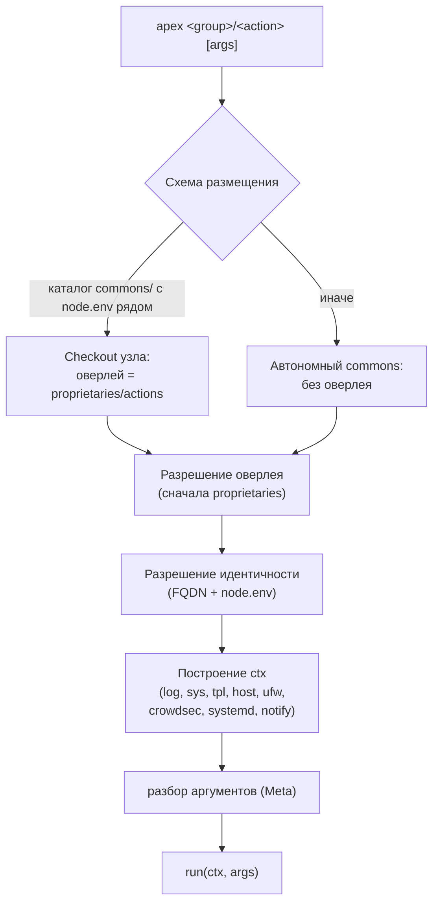

Фреймворк apex делит автоматизацию флота между одним общим репозиторием ([«commons»](/apex/glossary#commons)) и отдельными репозиториями для каждого [узла](/apex/glossary#node). В commons сосредоточено всё общее для флота: [движок](/apex/glossary#engine), стандартные [действия](/apex/glossary#action) и [ядровая композиция](/apex/glossary#core-composition). Репозиторий узла содержит специфичные для хоста данные: его идентичность, хостовые [конфигурации](/apex/glossary#configs), сервисные [композиции](/apex/glossary#compositions) и локальные [проприетарии](/apex/glossary#proprietaries).

## Четыре опоры {#pillars}

Каждый репозиторий узла имеет одинаковую структуру:



  
  
  
  
  
  



| Опора | Содержимое | Владение |
|---|---|---|
| `commons/` | Git-субмодуль → `apex.ermnvldmr.com`, закреплённый на релизном теге | Общее, версионируемое |
| `proprietaries/` | Узло-локальные действия, библиотеки и исходники инструментов ([накладываются оверлеем](/apex/glossary#overlay) поверх commons) | Узел |
| `configs/` | Исходники конфигурации хоста: `ufw/`, `cron/crontab`, `systemd/`, `crowdsec/` | Узел |
| `compositions/` | По одному каталогу на проект, ядровая обёртка `apex/` и реестр адресации | Узел |

Фиксация субмодуля — версионный контракт фреймворка: узел выполняет именно ту версию движка и ядровой композиции, которая зафиксирована в его gitlink. Обновление узла выполняется явно: достаточно переключиться на новый тег внутри `commons/` и закоммитить изменённый указатель.

## Поток диспетчеризации {#dispatch}

Лаунчер `commons/apex` работает с локальным чекаутом; передавать узел в качестве аргумента не нужно нигде.

Движок определяет режим работы по своему расположению на диске. Если он запущен из каталога `commons/`, а в родительском каталоге присутствует `node.env`, то родительский каталог принимается за корень репозитория узла, а `proprietaries/actions/` становится деревом оверлея. При любом другом расположении commons считается автономным чекаутом и выступает собственным корнем.

Команда перечисления (`apex --help`) никогда не импортирует модули действий: краткие описания и маркеры отключения извлекаются статически с помощью модуля `ast`. При диспетчеризации загружается ровно один модуль по вычисленному пути. Подробнее — в разделе [Концепция: Действия и оверлей](/apex/concepts/actions-and-overlay).

## Модель «capture-up» {#capture-up}

Команда `apex sync/repository` фиксирует рабочее дерево и версию commons
в ветке `sync/<node>`, выполняет rebase на `origin/main` и отправляет ветку
с флагом `--force-with-lease`. Если в commons есть незакоммиченные изменения
или каталог `compositions/` отсутствует, команда отказывается работать.
Конфликт rebase прерывает синхронизацию.

Проверку и слияние этой ветки определяют правила репозитория. APEX не поставляет
CI-сценарий слияния и не требует определённого способа размещения репозиториев.

## Проектные ограничения {#constraints}

- **Только стандартная библиотека (stdlib).** Движок работает на штатном Python 3 из Debian — без `pip` и сторонних зависимостей. Каталог `vendor/` зарезервирован для зафиксированного чистого Python-кода, но по умолчанию поставляется пустым.
- **Ручные compose-файлы.** Никаких промежуточных манифестов или кодогенерации: файлы compose служат единственным источником истины.
- **Автоматическая проверка вместо соглашений.** Всё, что можно проверить или применить автоматически, выполняется действием (проверка якорных IP, откат crontab, самовосстановление блоков-маркеров), а не остаётся на совести документации.

---

**См. также:**

- [Концепция: Действия и оверлей](/apex/concepts/actions-and-overlay)
- [Концепция: Разрешение идентичности узла](/apex/concepts/node-identity)
- [Руководство: Сборка репозитория узла](/apex/guides/node-repository)
